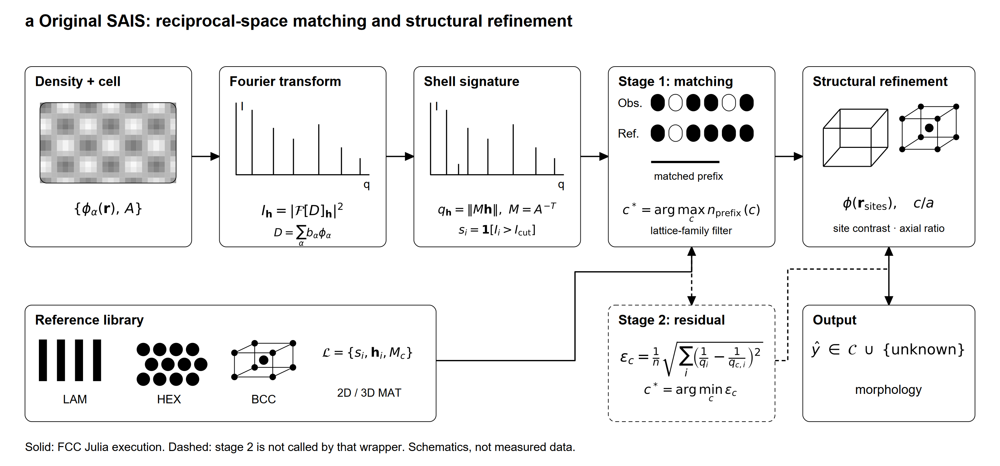

# SAIS

SCFT phase identification: Fourier reflection matching, dimensional routing,
real-space geometry/topology checks, and convergence/free-energy evidence gates.

## Versions

| Git ref | Purpose |
| --- | --- |
| `main`, tag `v4.0.1-bundled` | Stable v4.0.1 classifier with bundled reference libraries |
| `develop/v4.0.2` | Experimental supercell and structure-check development |

The original `v4.0.1` tag remains the unchanged code-only snapshot. For a
ready-to-run stable checkout use `main` or `v4.0.1-bundled`.

Historical directory names are retained. `SOURCE_MANIFEST.json` records this
checkout's source hashes; development changes do not alter the stable tags.
Editing or running this repository does not deploy either version or alter the
production database.

## Implementation lineage: Julia v3 → Python v4

**Yes: the audited original SAIS scripts are Julia; both v4.0.1 and v4.0.2
use a Python reimplementation of the recognition pipeline.** They reuse the
original MAT reference libraries and scattering ideas, with additional matching,
geometry and evidence rules. They are not just a Python interface around a Julia
process, and they are not numerically identical translations of the original.
The underlying SCFT solver was not rewritten here.

| Baseline / version | Recognition implementation | Relationship |
| --- | --- | --- |
| v3, our local name for the server baseline | Julia, audited FCC `SAIS_0902.jl` | Original reflection/extinction matching, peak-residual function and structural refinement |
| v4.0.1, stable | Python, `entry.py` → `investigation068/` → `structure061/run.py` | Reimplemented scattering; dimensional routing, structural checks and joint solver evidence |
| v4.0.2, experimental | Python, same entry point on `develop/v4.0.2` | Adds validated cell-representation handling, diagnostics and conservative acceptance checks |

The paper describes reflection/extinction matching followed by peak-position
comparison. **The peak-position residual is original SAIS content, not a v4
invention.** In the audited FCC snapshot, `stage2()` exists, but
`identify_phase_and_structure()` calls only `stage1()`. Consequently, the paper's
method and that wrapper's executed path must be distinguished. “v3” is not
asserted to be an official upstream release tag or the final publication code.

Method reference: Zhang Y.-C., Huang W.-L. and Liu Y.-X., *Automated
Identification of Ordered Phases for Simulation Studies of Block Copolymers*,
Chinese Journal of Polymer Science **42** (2024), 683–692.
[Paper and DOI](https://doi.org/10.1007/s10118-024-3084-x).

### Original SAIS method and audited Julia workflow



[Editable SVG](docs/figures/sais-v3-workflow.svg). Solid: audited Julia path;
dashed: original stage 2, not called by that wrapper. All visual examples are
schematic; symbols and implementation details are in [the method notes](docs/method-notes.md).

### v4.0.1 / v4.0.2 updates mapped onto the v3 components


[Editable SVG](docs/figures/sais-v4-components.svg) ·
[View both framework diagrams](docs/workflow-diagrams.html).
The original v3 components and flow are retained. Updates are attached inside
the corresponding components: black for the v3 baseline, blue for v4.0.1,
green for v4.0.2. Baseline density shading is grayscale.

| Component | v4.0.1 stable | Additional v4.0.2 development work |
| --- | --- | --- |
| Input / dimensions | HDF5/MAT loading, real-cell handling, DIS guard, 1D and effective-2D routing | Validated repeated-cell and bounded mixed-basis/sheared-cell proposals |
| Scattering | Consistent FFT normalization, relative thresholds, monotonic peak alignment, common-length inverse-q residual and tie rejection | Weak allowed-peak diagnostics; centering and numerical-leakage checks |
| LAM | Continuous-period layer checks and joint evidence | Weak-peak, unequal-layer and sampling diagnostics; one-layer CV is unavailable rather than zero |
| Particles | Scattering plus real-space consistency checks | Point arrangements and relative-level domain checks; restricted approximate SC supercells |
| Acceptance | Morphology and convergence/energy gates | Explicit LAM veto; both-component particle motifs; cubic-power and full signed centering checks; necessary planar/network checks |
| Output | Versioned candidate, status and reasons | Additional acceptance evidence; unresolved representations are withheld |

Relevant development modules: [supercell402.py](structure061/supercell402.py),
[mixed_basis402.py](structure061/mixed_basis402.py),
[approximate_particle402.py](structure061/approximate_particle402.py),
[lam_family402.py](structure061/lam_family402.py),
[lam_peak402.py](structure061/lam_peak402.py),
[extinction402.py](structure061/extinction402.py) and
[acceptance402.py](structure061/acceptance402.py).
These development-only links refer to the `develop/v4.0.2` checkout.

**Implemented checks and offline audits are separate.** The latest BCC/FCC audit
also tests complex Fourier-phase symmetry after fitting the origin. That test
is an offline diagnostic, not an acceptance rule in either classifier. Power
symmetry and centering checks already in v4.0.2 do not establish the same result.

## Validation statistics — 2026-11-24

**Independent ground-truth accuracy has not yet been established.** The following
numbers report structural-screen support and assistant visual agreement for the
latest locally patched v4.0.2. They must not be quoted as a measured full-library
precision of 100%. Passing classification also does not prove equilibrium
stability. All denominators below are explicit.

### Combined audit summary

| Phase | Machine accepted | Structurally reviewed | No new audit flag | Unresolved flags | Structural audit pass rate |
| --- | ---: | ---: | ---: | ---: | ---: |
| BCC | 1,516 | 1,516 | 1,514 | 2 | 99.87% |
| FCC | 1,116 | 1,116 | 1,116 | 0 | 100% |
| LAM | 804 | 804 | 804 | 0 | 100% |
| HEX | 1,973 | 1,973 | 1,973 | 0 | 100% |
| HCP | 960 | 960 | 952 | 8 | 99.17% |
| C3 | 734 | 734 | 727 | 7 | 99.05% |
| SC | 1,414 | 1,414 | 1,414 | 0 | 100% |
| iHPa | 914 | 914 | 914 | 0 | 100% |
| DSc | 302 | 302 | 300 | 2 | 99.34% |
| DIS | 254 | Not expanded | — | — | — |

All 9,733 accepted BCC/FCC/LAM/HEX/HCP/C3/SC/iHPa/DSc cases have now received numerical structural
review. Pass rate = cases without a new audit flag / all accepted cases of that
phase. **This is not independently adjudicated accuracy or full visual review.**
The two BCC, eight HCP, seven C3 and two DSc flags are unresolved, not confirmed errors. DIS retains the previous
25 visual comparisons; no new full DIS audit was requested.

LAM review independently checks Fourier-line support and subgrid level-crossing
spacings and widths at relative levels 0.35/0.50/0.65. One-layer variability is
unavailable, not zero. HEX review checks periodic centers and three triangular
neighbor shells across those levels for both component choices. Positive and
negative controls cover ideal/oblique LAM, unequal layers, transverse modulation,
triangular HEX and square-lattice alternatives. LAM/HEX input hashes remained
unchanged in all 2,777 cases. These necessary checks do not prove unique
space-group identity or global thermodynamic stability.

The independent LAM audit initially flagged 23 cases because of grid-quantized
maxima, flat plateaus and coordinate-axis averaging of oblique layers. Replacing
these audit diagnostics with Fourier-line reconstruction and subgrid crossings
removed the audit artifacts; the classifier itself was not changed. Final
per-case audit records are outside Git under
`/home/zyc/polymer-db/full-positive-audit-20261124/lam_refined_v2/results` (LAM)
and `full-positive-audit-20261124/results` (HEX). Raw densities are not bundled.

HCP review checks isolated solid domains, six in-plane neighbors and three
hollow-site neighbors in each adjacent layer, with ABAB stacking and a free
axial ratio. C3 checks the honeycomb center arrangement: neighbor-shell counts
3/6/3 and distance ratios (1, sqrt(3), 2). SC checks shell counts
6/12/8, ratios (1, sqrt(2), sqrt(3)), solid-domain Euler counts and complex cubic
Fourier-phase consistency. Shell grouping uses a 3% window; diagnostics run at
relative density levels 0.35/0.50/0.65 and consider both component choices.

This additional 3,108-case scan initially raised 54 flags. Repeating the same
checks with 2x/4x periodic Fourier interpolation resolved 39 HCP grid-location
flags; no tolerance was widened. Interpolation adds no new SCFT information.
Eight HCP stacking/center-consistency flags and seven C3 shell/level-consistency
flags persist. They require further adjudication; they are not established
alternative phases. The eight HCP run IDs are 6297, 7679, 7782, 19434, 20405,
20571, 20804 and 21069; the seven C3 IDs are 6716, 6722, 6726, 7470, 18358,
18448 and 18925. Controls distinguish ABAB from AA stacking and C3 from HEX.
All additional input hashes remained unchanged, with no execution errors in
the completed scan. Audit evidence is stored outside Git in
`full-positive-audit-20261124/hcp-c3-sc-v2/results` and
`full-positive-audit-20261124/hcp-c3-sc-refined`; its summary is
`full-positive-audit-20261124/hcp-c3-sc-summary.json` on FCC. Classification code,
database labels and online results were not modified.

iHPa review adds a 914-case AA-stack check: two conventional-cell domains,
six in-plane neighbors, one aligned neighbor in each adjacent layer, solid-domain
Euler counts and free axial ratio across three relative density levels. All 27
initial center-location flags pass the same checks after 2x/4x periodic Fourier
interpolation; tolerances are unchanged.

DSc review covers all 302 cases: eight discrete solid domains, tetrahedral bond
angles, neighbor shells 4/12/12 with ratios (1, sqrt(8/3), sqrt(11/3)), full FCC
centering and origin-fitted complex Fourier relations for 48 diamond
rotation/translation representatives. The latter include fractional translations;
fixed-origin cubic rotations alone are insufficient. The two remaining flags,
8343 and 20467, have maximum relative errors 0.283% and 0.281%, above the 0.1%
engineering flag line. Their diamond center arrangements still pass.

The audited DSc reference explicitly allows (222). Extra cancellations of an
ideal point-scatterer basis must not be imposed on a general soft density field.
An initial audit probe doing so was discarded, not used to classify all 302 cases
as failures. A projected soft-field control has nonzero (222) yet satisfies the
diamond symmetry relations to about 1.4e-15; a Gaussian FCC negative fails those
relations. The final rule and its evidence are recorded in the external audit
scripts `refine_ihpa_dsc.py`, `finalize_ihpa_dsc.py` and
`full-positive-audit-20261124/ihpa-dsc-summary.json`. All 1,216 additional input
hash checks passed. Neither classifier version, database labels nor online
results changed.

The independent implementation checks particle centers and the first three
neighbor shells. Its complex Fourier-phase audit flags **BCC runs 6586 and 8342**:
relative phase-symmetry errors are approximately 0.220% and 0.126%, respectively,
against an engineering flag level of 0.1%. Their particle arrangements still
support BCC. Whether these small conflicts reflect numerical error or physical
asymmetry is unresolved; neither is a confirmed wrong-phase prediction.
The audit has not changed their machine labels.

The random visual sample uses seed `20261124`, with 50 BCC and 50 FCC examples;
eight targeted examples were also viewed (108 total). Assistant inspection is
not independent expert adjudication. Nineteen cases change domain counts only
at outer relative levels 0.2/0.8; these were not counted as confirmed phase errors.

For LAM/HEX/DIS, all 1,356 historical visual records match their current
run/density hashes; 1,281 have a clear prior interpretation. Only the currently
accepted subset is counted as reviewed in the table. These are development examples,
marked `human_confirmed=false`, not a held-out expert-labeled test set. There
are no conflicting accepted labels within the comparable subset, but its
selection cannot establish full-population precision or recall.

### Full regression inventory, not an accuracy table

The latest acceptance patch processes the **27,544-record inventory**. Of these,
26,447 have registered input paths, 1,096 lack an input, and one has an unresolved
source association. A registered path does not mean a valid density or verified
solver record. The patched result has **10,236 named cases: 9,982 ordered and
254 DIS**. Relative to the immediately preceding v4.0.2 snapshot, 498 names
were withheld, with **zero newly assigned names and zero renamed cases**.

| Current phase | Accepted cases | Current phase | Accepted cases |
| --- | ---: | --- | ---: |
| LAM | 804 | HEX | 1,973 |
| BCC | 1,516 | FCC | 1,116 |
| SC | 1,414 | HCP | 960 |
| iHPa | 914 | C3 | 734 |
| DSc | 302 | A15 | 98 |
| PtS | 45 | DD | 41 |
| SG | 32 | DG | 29 |
| SPC | 4 | DIS | 254 |

For phases without adjudicated examples, an accuracy percentage remains
**unmeasured**, not zero and not implicitly 100%. Reference-library name matches
are provenance checks and are not independent validation.

The 498 withheld names comprise 432 full-spectrum centering conflicts, 17 cubic
directional-power conflicts, 19 particle-motif failures, 17 planar-geometry
failures, four network checks, one layer check, two unverified square/planar
representations and six unverified named variants. The inventory still contains
one pre-existing input-format execution error (run 26758), left unlabelled.
Withholding can include false negatives and is not proof that the original
candidate was wrong.

Audit provenance: local reports `SAIS-acceptance-regression-20261124/summary.json`,
`SAIS-accuracy-audit-20261124/statistics.json` and
`SAIS-BCC-FCC-audit-20261124/summary.json`. These external validation artifacts
and the density pool are not bundled in Git; the tables are a dated summary,
not a dataset downloadable from this repository. The regression recorded no
input-hash changes, database writes, training-label backfill or online deployment;
v4.0.1 stayed unchanged. Full details of the audited call chain and limitations
are in [the method notes](docs/method-notes.md).

## Install and run

Use Python 3.12+ with the dependency snapshot in `requirements.txt`.

```sh
git clone https://github.com/PolyorderLab/SAIS.git
cd SAIS
# Optional experimental version: git switch develop/v4.0.2
python -m venv .venv
# Linux/macOS: source .venv/bin/activate
# Windows PowerShell: .venv\Scripts\Activate.ps1
python -m pip install -r requirements.txt
python tools/reference_files.py
python tools/verify_source.py
python tools/smoke_recognition.py
python entry.py --batch /path/to/cases.json --out /path/to/new-output
```

Activate the virtual environment using the command for your operating system.
Both reference libraries are included as regular Git files: no Git LFS setup,
separate download, reference-file copying, Julia installation, or database
connection is needed for `entry.py`. The repository is private, so cloning
requires GitHub access. `smoke_recognition.py` generates temporary synthetic LAM
and DIS inputs, invokes the real batch entry point, checks the expected labels,
and removes its temporary files.

`cases.json` has this structure (use unique filesystem-safe IDs):

```json
{"cases": [{"id": "sample001", "input": "/path/to/scft-result", "metadata_dir": "/path/to/scft-result"}]}
```

SCFT directories contain `densities.h5` and `summary.yml`; provide the original
`config.yml` and solver traces when available for the joint evidence gate.
The loader also supports the existing MAT density formats. Missing solver
metadata can leave a morphology candidate pending verification.
Always supply `--batch` and a new `--out` outside the input tree.
The default historical fixture paths are not bundled.

Outputs contain per-case JSON evidence and `summary.json`. Candidate morphology
is not proof of global thermodynamic stability. These entry points do not write
database phase labels; source input hashes are checked before and after loading.

## Bundled references and data policy

The original `reference2d_20231228.mat` and `reference3d_20240111.mat` are included
under `scft_phase_identifier_v3/vendor/` (about 20.4 MB total).
`references/manifest.json` records their names, sizes, and SHA-256 values.
`python tools/reference_files.py` checks the bundled files. The optional
`--source` argument is only for restoring matching files from a local backup.
User density fields, batch pools, generated plots/results, databases,
credentials, and environment directories remain excluded from Git.
No new software/data license is inferred from this code snapshot.

## Layout

- `entry.py`: supported batch entry point; preserves historical import routing.
- `structure061/`: scattering, geometry, topology, and evidence integration.
- `investigation068/`: final trace/evaluation alignment used by both versions.
- `phase_identifier_robust047/`: inherited loaders and structural helpers.
- `tools/`: reference setup, source integrity, and data-free checks.

Legacy replay/report/publishing utilities are retained for provenance; some
reference server-specific paths, old external tools, or unbundled integration
fixtures. They are not standalone entry points. The online frontend/database
deployment is not packaged here.

## Checks

```sh
python tools/verify_source.py
python tools/reference_files.py
python tools/check_synthetic.py
python tools/smoke_recognition.py
python tests/test_acceptance402.py  # develop/v4.0.2 only
python entry.py --help
```

Synthetic checks cover fractional-grid LAM periods, unequal-layer rejection,
directional/ring controls, energy and convergence gates, and trace alignment.
Historical full-library regressions require external input data and are not
rerun by these checks. Repository packaging does not change previous scientific
validation claims.

## v4.0.2 acceptance checks (2026-11-24)

`structure061/acceptance402.py` adds conservative checks before the existing
convergence/free-energy gate. It can withhold a proposed phase; it never
substitutes another phase or promotes a pending case.

- LAM: an explicit failed layer diagnostic now blocks acceptance. Weak internal
  peaks alone are not treated as defects when the repeated motif is consistent.
- Particles: require persistent isolated solid domains and a compatible point
  motif. Both components are considered; spheres need not be the minority.
  SC/BCC/FCC/DSc/A15 also receive directional cubic-power checks. BCC/FCC/DSc
  require full signed-spectrum centering, including modes outside the first ten
  reference shells. The earlier `1e-8` centering-power policy is retained.
- HCP/iHPa/PtS: check their conventional-cell point motifs and metric families;
  no ideal close-packing axial ratio is imposed. Unverified representations or
  named variants remain pending.
- Networks: combine reference-cell periodic component counts, spanning, and
  periodic solid Euler characteristics across relative levels. These are
  necessary topology checks, not a complete skeleton or space-group proof.
- HEX/C3/SPC: require relative-level planar geometry consistent with the proposed
  class. Unverified three-dimensional-to-planar representations remain pending.

Policies are explicit in the output `acceptance_evidence`. Withheld candidates
are retained separately for investigation. Coarse grids and unverified cell
representations can produce false negatives; passing these checks still does
not prove a globally stable equilibrium phase or zero classification error.
