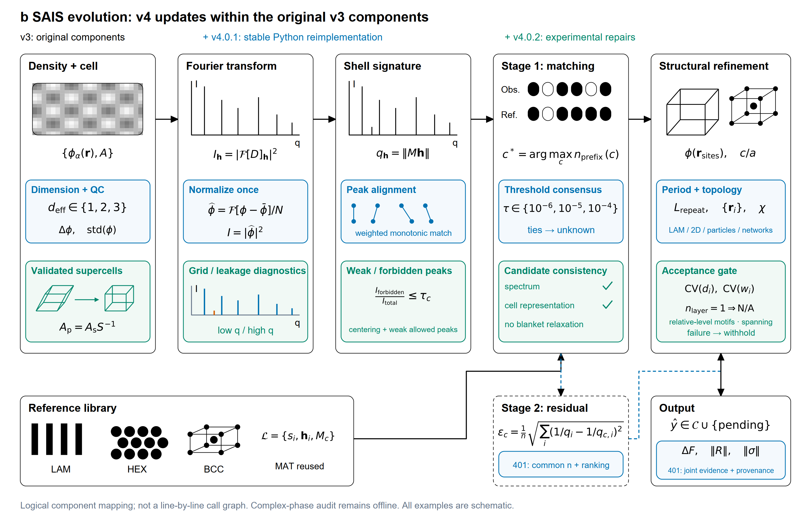

# SAIS

SCFT phase identification: Fourier reflection matching, dimensional routing,
real-space geometry/topology checks, and convergence/free-energy evidence gates.

## Method overview


Original Julia workflow. Solid arrows show the audited FCC execution path;
dashed arrows show the original stage-2 method not called by that wrapper.
[Vector SVG](docs/figures/sais-v3-workflow.svg).



Updates within the v3 framework: black = original components, blue = v4.0.1,
green = v4.0.2. Illustrations are schematic, not measured results.
[Vector SVG](docs/figures/sais-v4-components.svg).

[Detailed implementation notes and structural audit statistics](https://github.com/PolyorderLab/SAIS/blob/develop/v4.0.2/README.md)
are maintained with the experimental code. These documentation images do not
change the stable classifier on `main` or the frozen version tags.

## Versions

| Git ref | Purpose |
| --- | --- |
| `main`, tag `v4.0.1-bundled` | Stable v4.0.1 classifier with bundled reference libraries |
| `develop/v4.0.2` | Experimental supercell and structure-check development |

The original `v4.0.1` tag remains the unchanged code-only snapshot. For a
ready-to-run stable checkout use `main` or `v4.0.1-bundled`.

Algorithm files retain their original contents and historical directory names.
`SOURCE_MANIFEST.json` records their SHA-256 hashes. Creating this repository
does not deploy either version or alter the production database.

## Install and run

Use Python 3.12+ with the dependency snapshot in `requirements.txt`.

```sh
git clone https://github.com/PolyorderLab/SAIS.git
cd SAIS
# Optional experimental version: git switch develop/v4.0.2
python -m venv .venv
# Linux/macOS: source .venv/bin/activate
# Windows PowerShell: .venv\Scripts\Activate.ps1
python -m pip install -r requirements.txt
python tools/reference_files.py
python tools/verify_source.py
python tools/smoke_recognition.py
python entry.py --batch /path/to/cases.json --out /path/to/new-output
```

Activate the virtual environment using the command for your operating system.
Both reference libraries are included as regular Git files: no Git LFS setup,
separate download, reference-file copying, Julia installation, or database
connection is needed for `entry.py`. The repository is private, so cloning
requires GitHub access. `smoke_recognition.py` generates temporary synthetic LAM
and DIS inputs, invokes the real batch entry point, checks the expected labels,
and removes its temporary files.

`cases.json` has this structure (use unique filesystem-safe IDs):

```json
{"cases": [{"id": "sample001", "input": "/path/to/scft-result", "metadata_dir": "/path/to/scft-result"}]}
```

SCFT directories contain `densities.h5` and `summary.yml`; provide the original
`config.yml` and solver traces when available for the joint evidence gate.
The loader also supports the existing MAT density formats. Missing solver
metadata can leave a morphology candidate pending verification.
Always supply `--batch` and a new `--out` outside the input tree.
The default historical fixture paths are not bundled.

Outputs contain per-case JSON evidence and `summary.json`. Candidate morphology
is not proof of global thermodynamic stability. These entry points do not write
database phase labels; source input hashes are checked before and after loading.

## Bundled references and data policy

The original `reference2d_20231228.mat` and `reference3d_20240111.mat` are included
under `scft_phase_identifier_v3/vendor/` (about 20.4 MB total).
`references/manifest.json` records their names, sizes, and SHA-256 values.
`python tools/reference_files.py` checks the bundled files. The optional
`--source` argument is only for restoring matching files from a local backup.
User density fields, batch pools, generated plots/results, databases,
credentials, and environment directories remain excluded from Git.
No new software/data license is inferred from this code snapshot.

## Layout

- `entry.py`: supported batch entry point; preserves historical import routing.
- `structure061/`: scattering, geometry, topology, and evidence integration.
- `investigation068/`: final trace/evaluation alignment used by both versions.
- `phase_identifier_robust047/`: inherited loaders and structural helpers.
- `tools/`: reference setup, source integrity, and data-free checks.

Legacy replay/report/publishing utilities are retained for provenance; some
reference server-specific paths, old external tools, or unbundled integration
fixtures. They are not standalone entry points. The online frontend/database
deployment is not packaged here.

## Checks

```sh
python tools/verify_source.py
python tools/reference_files.py
python tools/check_synthetic.py
python tools/smoke_recognition.py
python entry.py --help
```

Synthetic checks cover fractional-grid LAM periods, unequal-layer rejection,
directional/ring controls, energy and convergence gates, and trace alignment.
Historical full-library regressions require external input data and are not
rerun by these checks. Repository packaging does not change previous scientific
validation claims.
